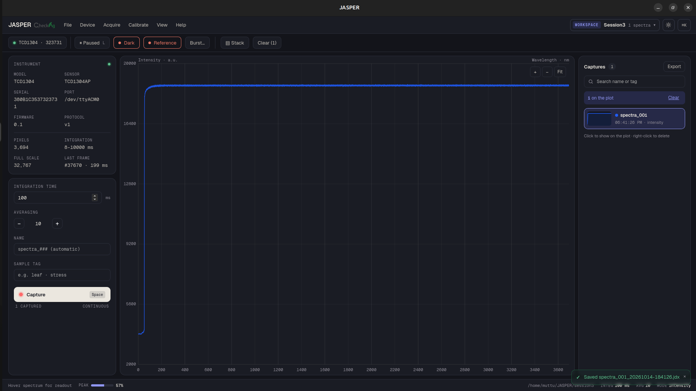

# JASPER — Spectral Data Platform

Desktop app from **CheckAG** for running the JASPER spectrometer, a TCD1304 linear CCD (3694
pixels) on a Renesas RA2A1 board connected over USB. It shows the live spectrum,
captures and organises spectra into workspaces, applies dark and reference corrections, and
exports the results. Scripts and AI agents can drive the instrument through the same interface
the GUI uses.

Built with Tauri 2 (Rust) and React 19 + TypeScript. Linux is the development platform;
Windows 10/11 is the main target.



## The app

Everything is on one screen: a menu bar, a toolbar, and three columns.

```
┌ File  Device  Acquire  Calibrate  View  Help ─────────── workspace ▾  ☾  ⌘K ┐
│ ● instrument   ● Live  Dark  Reference  Burst…                              │
├──────────────┬──────────────────────────────────────────────┬───────────────┤
│ Acquisition  │                                              │ Captures      │
│  integration │              live spectrum plot              │  search       │
│  averaging   │        zoom · pan · cursor readout           │  cards        │
│  name, tag   │                                              │  burst groups │
│  [ Capture ] │                                              │  Export       │
├──────────────┴──────────────────────────────────────────────┴───────────────┤
│ status bar: cursor x / y, device state                                      │
└─────────────────────────────────────────────────────────────────────────────┘
```

### Working with the instrument

- **Connect** from the toolbar chip or *Device ▸ Instruments…*. Connected boards are listed by
  serial number, model and firmware. If the cable is pulled, the app reconnects to the same
  board by itself, keeps dark, reference and settings, and resumes Live.
- **Live** (`L`) streams the spectrum. Turn it off to freeze the plot before capturing.
- **Integration time and averaging** are set in the left panel. Values are limited to what the
  device accepts. The last values are restored on the next start, and *Acquire ▸ Settings
  profiles…* saves named sets.
- **Dark** (`D`) and **reference** (`R`) are taken from the toolbar. With both held, the trace is
  shown as absorbance; otherwise as raw intensity. A banner warns when the dark no longer
  matches the current settings, and another when the signal saturates (98% of full scale).
- **Capture** (`Space`) averages N scans and saves the result. **Burst…** takes up to 1000
  captures in a row, with an optional interval between them.
- **Firmware update** and **diagnostics** are under *Device*. A firmware upgrade started by a
  script or agent waits for a person to approve it in the app.

### Captures and workspaces

- A **workspace** holds a set of captures, for example one sample batch. The switcher in the
  menu bar lists them by last use, and the app reopens the last one on start.
- Each capture is named from the *Name* field: `Leaf A_001`, `Leaf A_002`, … or `spectra_001`,
  … when the field is empty. The name stays filled for the next capture; the *Tag* clears.
- The **Captures panel** shows each capture as a card with a small preview. Click cards to
  overlay them on the plot. Shots from one burst fold into a single group with *Show all*.
- **Export** writes CSV with a metadata header or JCAMP-DX. *File* lists recent workspaces and
  recent exports.

### View

- Light theme by default, dark theme from *View* or the moon button.
- Three densities (*View ▸ Density*): compact, standard and comfortable. They change text size,
  control height and spacing.
- `⌘K` / `Ctrl+K` opens the command palette. *Help ▸ Keyboard shortcuts* lists the keys.

### Where data is stored

| What | Where |
|---|---|
| Captures as `.jdx` files, one folder per workspace | `~/JASPER/` (override with `JASPER_DATA_DIR`) |
| Database, settings, profiles, recent lists | the app data folder: `~/.local/share/com.checkag.jasper/` on Linux |

## Scripting and AI agents

While the app runs, it serves a **Device API** on `127.0.0.1:8765`: JSON-RPC 2.0, one JSON object
per line. The GUI, scripts and agents all go through the same dispatcher, so they get the same
limits, the same values and one audit log.

```bash
cd clients/python
python -m jasper read device.state acquisition.integration_time_ms
python -m jasper write acquisition.averages 8
python -m jasper invoke capture tag=NE-01
python -m jasper watch spectrum-frame capture-saved
```

```python
from jasper import Client
with Client() as j:
    j.write("acquisition.integration_time_ms", 50)
    print(j.invoke("capture", tag="NE-01")["saved"]["file"])
```

The client uses only the standard library. Every variable and command is described in
`clients/python/jasper/reference.yaml`.

For AI agents, `python -m jasper.mcp` runs an MCP server over stdio. It is read-only for now: the
`jasper_read` tool plus the reference file.

## Development

### Prerequisites

- Rust (stable) and Node.js with npm
- On Linux, the Tauri system libraries: `libwebkit2gtk-4.1-dev libgtk-3-dev libssl-dev
  librsvg2-dev libayatana-appindicator3-dev libsoup-3.0-dev`
- Python 3 for the client, the simulator and the compute sidecar
  (`pip install -r python-sidecar/requirements.txt`)

### Run

```bash
npm install
./run.sh
```

`run.sh` frees port 5173, puts cargo on the PATH, and sets the environment variables this
machine needs when launched from a VS Code snap terminal (`GTK_EXE_PREFIX`, `LD_PRELOAD`).
Plain `npm run tauri dev` works from a normal terminal. Vite is pinned to 5.

**Without a board:** start the simulator and point the app at its port.

```bash
python3 tools/tcd1304-sim.py --scene lines      # prints e.g. /dev/pts/7
JASPER_PORT=/dev/pts/7 ./run.sh
```

`JASPER_PORT` also connects a real port at startup (`/dev/ttyACM0`). Unset, the app starts with
no instrument.

### Build and test

```bash
npm run tauri build                 # installable app
cd src-tauri && cargo test          # backend, API and simulator tests
npx tsc -b                          # type-check the UI
```

### Layout

| Path | What |
|---|---|
| `src/` | React UI: `components/` (shell, dialogs, design primitives), `workspaces/acquire/`, `spectrum/` (plots), `store/` (Zustand), `lib/ipc.ts` |
| `src/styles/tokens.css` | Colours, type scale and density. All theming goes through these tokens |
| `src-tauri/src/` | Rust: `api/` (Device API and TCP server), `instrument/` (driver, `tcd1304/` protocol), `storage/` (SQLite, files), `commands/` |
| `clients/python/` | Python client, `jasper` CLI and MCP server |
| `python-sidecar/` | Compute sidecar (pre-processing, chemometrics), JSON-RPC over stdin/stdout |
| `tools/tcd1304-sim.py` | Board simulator on a pty |

The instrument protocol (protocol v1: ASCII commands, framed binary replies with CRC-16) is
specified in the firmware repository's `TCD1304_Timer_ADC/PROTOCOL.md`.

### Status

Stage 1 (instrument control, capture, workspaces, export, Device API) is mostly done. Wavelength
calibration in nm waits on a calibration lamp. The Analyze and Chemometrics screens are built but
not yet reachable from the one-screen layout. `PLAN.md`, `docs/PLAN-migration.md` and
`SESSION-HANDOFF.md` have the details.
